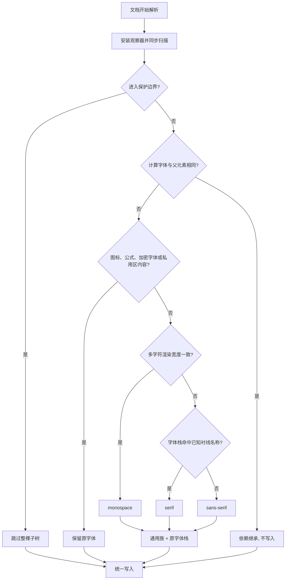
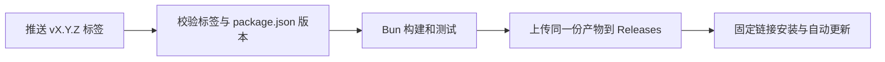

# 智能字体替换

适用于 **Chrome / Edge + Tampermonkey** 的单文件油猴脚本。按网页原字体的 sans、serif、mono 类别，在原字体栈前插入浏览器通用族，保留网页原有回退顺序；最终字形由浏览器的标准、无衬线、等宽字体设置决定。脚本在文档开始解析时启动并同步替换，首帧不会先绘制原字体。

```css
/* 网页原样式 */
font-family: Georgia, serif;

/* 脚本应用后；最终字形来自浏览器的 serif 设置 */
font-family: serif, Georgia, serif !important;
```

脚本仅修改 `font-family`，没有运行时依赖，不调用第三方字体服务，也不读写脚本自定义的存储。通用族例如 `serif` 的最终字体由浏览器设置决定；原字体栈保留为缺字回退，网页自带的 webfont 只在通用族缺少对应字符时参与回退。

## 安装

1. 在 Chrome 或 Edge 中安装并启用 [Tampermonkey](https://www.tampermonkey.net/)。
2. 打开 GitHub 仓库的 **Releases → Latest**，点击附件 `font-override.user.js` 安装；也可以将下面的固定链接导入 Tampermonkey。
3. 打开或刷新普通 HTTP / HTTPS 网页。脚本不需要额外配置。

如果脚本没有运行，先检查 Tampermonkey 是否启用、是否拥有当前网站的访问权限，以及浏览器是否允许扩展运行用户脚本；参见 [Tampermonkey 官方 FAQ](https://www.tampermonkey.net/faq.php)。浏览器内部页面和扩展商店不在脚本运行范围内。

固定安装链接格式如下，将 `OWNER/REPO` 替换为实际仓库名称。发布 workflow 的运行摘要也会显示可直接点击的安装链接；首次发布前该链接不可用。

```text
https://github.com/OWNER/REPO/releases/latest/download/font-override.user.js
```

Releases 中的脚本包含自动更新地址：Tampermonkey 通过 `.meta.js` 检查版本，通过 `.user.js` 下载新版，具体检查时机由管理器的更新设置决定。脚本名称与 namespace 保持不变。

源码使用 TypeScript 编写，仓库不提交编译后的 JS。尚未发布时，可以按下方开发步骤构建，再将本地 `dist/font-override.user.js` 的内容复制到 Tampermonkey 的新脚本编辑器中保存。

## 字形由浏览器设置决定

v2.0.0 起不再提供 sans / serif / mono 三项自选字体，也没有任何脚本自有配置；脚本固定插入三个通用族：

| 分类 | 插入的通用族 |
| --- | --- |
| sans | `sans-serif` |
| serif | `serif` |
| mono | `monospace` |

- 在 Chrome 或 Edge 的设置中调整**标准字体**、**无衬线字体**、**等宽字体**，即可决定三类文本的实际字形（`chrome://settings/fonts`，或 设置 → 外观 → 自定义字体）。
- 通用族始终排在最前，因此网页自带的 webfont 不会覆盖普通文本的字形；它仍保留在字体栈中，用于通用族缺字时的回退。
- 字体名称的语法与安装情况由浏览器处理；未安装或缺字时，浏览器继续查找字体栈中的后续字体。
- **升级说明**：旧版本的 `fontOverride.sans`、`fontOverride.serif`、`fontOverride.mono` 存储键不再被读取，也不会被删除；请改用浏览器字体设置。停用脚本使用 Tampermonkey 自带开关，随后刷新网页。

## 分类与保护



- **等宽检测**：使用隔离的测量节点比较多个拉丁字符的渲染宽度，按字体栈、字号、字重、样式、字体特性与语言缓存结果。不会仅凭名称包含 `mono` 或末尾带 `monospace` 判断。
- **衬线分类**：测量为非等宽后，按字体栈顺序匹配通用类别和内置的常见字体名称；未识别的自定义字体默认使用 sans。该判断是启发式的，浏览器没有直接提供字体衬线类别的通用 DOM 接口。
- **继承与幂等**：只处理计算字体系列与父元素不同的元素，其余依赖继承。读写分离：先按文档顺序收集读取结果，再统一写入；读取前临时恢复脚本自己写入的声明。已有完整目标前缀时不重复添加，重扫不会让字体栈增长。
- **首帧无闪烁**：`@run-at document-start` 安装 `MutationObserver`，在回调内同步完成新增子树的读取与写入。没有空闲回调、定时器或分批队列，新增内容进入绘制前就已经是替换后的字体。外部样式表的规则可能早于其 `load` 事件生效且不产生 DOM 变更；脚本在外部样式表未落定期间保留绘制前补扫，样式表全部加载或失败后停止，因此样式表带来的字体也会在首次绘制前完成替换。
- **动态更新**：节点插入/删除、属性变化、文本变化都在产生变更的同一任务内同步重扫受影响子树；`style` 变化先比较计算字体，未改变即跳过；重复的脏根去重。样式表加载、字体加载完成/失败、往返缓存恢复和窗口尺寸变化同样触发同步重检。
- **公式只保护不插入 `math`**：SVG、MathML（`math`）、KaTeX（`.katex`）、MathJax（含 `mjx-container`）、`.mwe-math-element`、`.math`、`.formula`、`.equation` 等边界整棵剪枝；数学字体名（Cambria Math、STIX、Latin Modern Math、XITS Math、TeX Gyre、Asana Math、Noto Math、Libertinus Math、Fira Math、Garamond Math 等）保持原字体栈，不插入任何前缀。
- **连字图标检测**：对首选字体是网页 `@font-face` 的元素，比较测试词的整词宽度与逐字符宽度之和；比值低于 0.6 判定为连字图标字体并保持原字体。Material Icons 实测约 0.25，普通比例字体为 1.00。系统字体不参与该判定，测量探针复制元素的计算字体特性。
- **已知图标内容**：识别 Material Icons / Symbols、Font Awesome、常见 iconfont、图标类名、直接文本或伪元素中的私用区字符；保留其原字体。继承型图标内容在祖先被替换时会写入等值的原字体声明，避免被通用族覆盖。
- **加密字体保护**：雨课堂等页面通过特定字体把底层不成句的汉字映射为可读字形；在其前面插入普通字体会破坏显示。脚本按完整字体名、不区分大小写识别 `exam-data-decrypt-font`，并保护 `.xuetangx-com-encrypted-font` 标记的整个子树，保留原字体栈及顺序。动态标记和新增内容同样处理，移除标记后恢复正常替换。不会修改文字内容，也不会统一跳过普通 `@font-face` 字体。

仅保留回退字体并不能保证所有图标安全：例如 Material Icons 的 `home` 是字母连字，普通字体已经含有这些字母，不会再为整个单词回退。因此图标保护先于字体替换。[Material Icons 原理](https://developers.google.com/fonts/docs/material_icons)、[字体回退规则](https://developer.mozilla.org/en-US/docs/Web/CSS/Reference/Properties/font-family)

## 已知边界

- 处理普通 DOM 和 **Tampermonkey 实际注入的 iframe**。脚本不访问跨域父页面；iframe 是否能运行由浏览器及管理器权限决定。
- 不遍历网站的 Shadow DOM，不处理 Canvas 绘制文字或浏览器 PDF 阅读器。不改写独立声明字体的文本伪元素；普通继承型伪元素随宿主字体变化，命中图标或私用区内容时保留原字体。
- 不拦截 `CSSStyleSheet.insertRule()`、`replace()`、`adoptedStyleSheets` 等 CSSOM 操作，也不持续轮询 `:hover`、`:focus`、系统主题等无 DOM 变更的样式状态。后续可观察事件或刷新页面时会重新检测。
- 衬线分类依赖声明和已知名称，不代表准确识别每个字符最终使用的实际字体。混合文字、字体子集、定制图标字体、未知加密字体或未识别的数学排版仍可能需要针对性适配；加密字体保护仅覆盖上述已确认的字体名和标记。
- 浏览器可能不枚举跨域样式表中的 `@font-face`；连字图标检测取不到网页字体集合时会退化为名称与私用区规则，不影响普通文本替换。
- 通用族始终优先，因此网页自选的 webfont 不再决定普通文本字形；这是「由浏览器设置决定字形」的直接结果。
- 同步扫描会在解析期占用主线程。继承跳过、保护剪枝、先读后写和测量缓存把开销压到每个独立声明一次读取；伪元素保护先从可读样式表中收集 `::before` / `::after` / `::marker` 规则的选择器，只对匹配到的元素读取伪元素计算样式（存在不可读的跨域样式表时回退为逐个检查）。存在未落定的外部样式表时，每个渲染更新会多一次补扫；只等待 `<link rel="stylesheet">`，不等待内联 `@import` 或 CSSOM 插入的样式表（后者不属于本脚本拦截的变更来源）。超大页面可能比空闲调度略慢，但不会出现字体闪烁。
- 重新检测会临时恢复相关 `font-family` 后在同一同步批次内写回。网站自己的 `MutationObserver` 仍可能看到这些内联样式变动；脚本不接管网站逻辑，也不保证与依赖 `style` 属性精确内容的组件完全兼容。

## 开发与测试

使用 **Bun 1.4.3** 安装依赖、构建、类型检查和运行测试，版本记录在 `.bun-version` 和 `package.json` 中。用户脚本运行于浏览器，不依赖 Bun。

```sh
bun install --frozen-lockfile
bun run --bun playwright install chromium
bun run check
bun run test
```

`bun run test` 会先构建，再执行构建验证和 Playwright 浏览器测试。浏览器测试加载 `dist/` 中的实际产物，并在页面脚本之前以 `document-start` 注入；不提供任何管理器 API 替身。真实等宽及图标字体来自 **仅用于开发测试** 的 `@fontsource/roboto-mono` 和 `@fontsource/material-icons`，由测试路由提供，不依赖外部字体服务。字体授权见相应依赖中的许可证文件。

其他开发命令：

| 命令 | 用途 |
| --- | --- |
| `bun run build` | 生成不压缩的单文件 IIFE 和元数据文件 |
| `bun run check` | 严格检查业务源码、构建工具和测试的 TypeScript 类型 |
| `bun run test:build` | 验证元数据、单文件输出、版本和发布地址 |
| `bun run test:browser` | 测试已有构建产物，不重新构建 |
| `bun run test:headed` | 重新构建并打开浏览器运行测试 |

TypeScript CLI 和 Playwright 均显式使用 `--bun`，避免按它们的 Node shebang 启动 Node。依赖版本由提交的 `bun.lock` 锁定。

### 源码结构

| 模块 | 职责 |
| --- | --- |
| `src/index.ts` | 创建扫描器并启动 |
| `src/font-families.ts` | 解析字体列表并合并前缀 |
| `src/classifier.ts` | 隔离测量、字体分类与缓存 |
| `src/protection.ts` | 图标、连字图标、伪元素、公式与已知加密字体保护规则 |
| `src/scanner.ts` | DOM 观察、同步读写、继承跳过、边界剪枝与重扫调度 |
| `src/types.ts` | 领域类型、通用族常量与字体快照工具 |
| `scripts/build.ts` | 打包、生成元数据及校验发布标签 |

业务源码独立检查 DOM 类型，Bun 类型只在工具与测试配置中启用。`dist/`、测试报告和依赖目录由 Git 忽略。

测试覆盖分类与缺字回退链、父子继承与写入次数、插入节点/类名/内联样式/lang 属性/文本的同步生效、与父元素同族的样式表声明、延迟样式表与媒体查询、外部样式表未落定时的绘制前补扫、延迟字体加载后的重新分类、图标及加密字体截图前后对比、公式与加密内容保护边界、整棵保护子树的读写次数、伪元素读取次数、连字图标宽度比、iframe、首帧无闪烁，以及重复重扫后字体栈不增长、自身写入后不再触发重扫。

可使用本机安装的 Chrome 或 Edge 运行同一套测试：

```sh
PLAYWRIGHT_CHANNEL=chrome bun run test
PLAYWRIGHT_CHANNEL=msedge bun run test
```

自动化测试验证真实浏览器中的脚本行为，但不代替实际 Tampermonkey 扩展验收：

1. 安装脚本，在有正文、代码和图标的页面确认字体已按类别替换。
2. 在浏览器设置中修改无衬线、衬线或等宽字体，刷新页面，确认对应文本跟随变化；代码仍等宽，常见图标保持正常。
3. 打开维基百科等含公式的页面，确认首屏没有原字体闪烁，公式与图标字形未被改写。
4. 在动态加载内容或切换主题后检查新内容；在 Stack Exchange、KaTeX 文档等页面确认公式渲染正常。
5. 在实际使用的网站发现不兼容时，通过 Tampermonkey 停用脚本并刷新；报告网站、原字体栈与浏览器字体设置，以便补充针对性测试。

## 发布到 GitHub Releases

[发布 workflow](.github/workflows/ci.yml) 在 PR 和 main 分支推送时执行检查；推送版本标签时，检查通过后将两份已测试的文件作为 Release 附件上传，不向 Git 提交构建产物。



首次使用前，将源码提交并推送至公开 GitHub 仓库，默认分支使用 `main`，并启用 Actions。安装附件需要可公开访问。workflow 使用内置 `GITHUB_TOKEN`，仅发布作业授予 `contents: write`，不需要配置个人访问令牌。

发布步骤：

1. 修改 `package.json` 中的版本号，作为唯一版本来源；当前开发版本为 `2.0.0`。
2. 运行 `bun run check` 和 `bun run test`，提交源码、配置与 `bun.lock`。
3. 推送提交，再推送对应版本标签。例如：

   ```sh
   git push origin main
   git tag v2.0.0
   git push origin v2.0.0
   ```

仅支持 `vX.Y.Z` 稳定版标签，必须与该提交的 `package.json` 版本完全一致；不匹配时构建失败，不能发布。后续发布使用递增版本和新标签，已经发布的版本不覆盖。

构建时从 `GITHUB_REPOSITORY` 自动生成当前仓库的更新地址。无此变量的本地构建省略更新地址；需要在本地检查发布元数据时可以运行：

```sh
GITHUB_REPOSITORY=OWNER/REPO bun run build
```

发布作业直接下载检查作业的产物，不重新构建。完成后，在运行摘要获取安装链接，并实际验证 Tampermonkey 的安装与更新。Playwright 与本地构建验证不替代远程发布及真实扩展验收。
