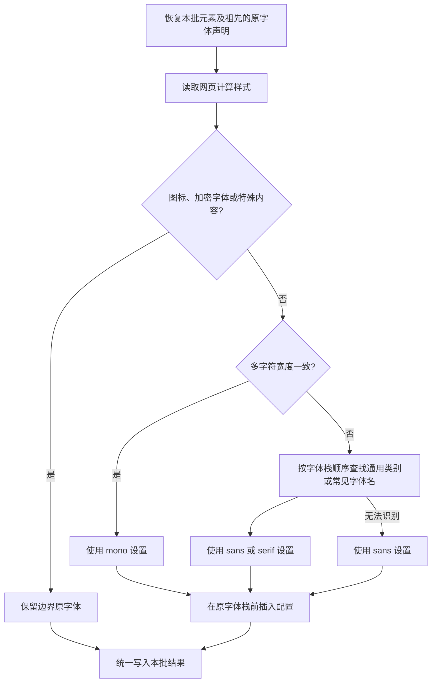
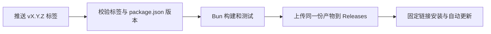

# 智能字体替换

适用于 **Chrome / Edge + Tampermonkey** 的单文件油猴脚本。按网页原字体的 sans、serif、mono 类别，在原字体栈前加入自选字体，保留网页原有回退顺序，并保护常见图标、公式和已知加密字体。

```css
/* 网页原样式 */
font-family: Georgia, serif;

/* 将 serif 设置为 "Noto Serif SC" 后 */
font-family: "Noto Serif SC", Georgia, serif !important;
```

脚本仅修改 `font-family`，没有运行时依赖，不调用第三方字体服务。字体需要已安装在本机，或由网页的 `@font-face` 提供；测量和应用可能触发网页自身的字体加载。

## 安装

1. 在 Chrome 或 Edge 中安装并启用 [Tampermonkey](https://www.tampermonkey.net/)。
2. 首版发布后，打开 GitHub 仓库的 **Releases → Latest**，点击附件 `font-override.user.js` 安装；也可以将下面的固定链接导入 Tampermonkey。
3. 打开或刷新普通 HTTP / HTTPS 网页。点击 Tampermonkey 图标，查看脚本提供的三项字体设置。

如果脚本没有运行，先检查 Tampermonkey 是否启用、是否拥有当前网站的访问权限，以及浏览器是否允许扩展运行用户脚本；参见 [Tampermonkey 官方 FAQ](https://www.tampermonkey.net/faq.php)。浏览器内部页面和扩展商店不在脚本运行范围内。

固定安装链接格式如下，将 `OWNER/REPO` 替换为实际仓库名称。发布 workflow 的运行摘要也会显示可直接点击的安装链接；首次发布前该链接不可用。

```text
https://github.com/OWNER/REPO/releases/latest/download/font-override.user.js
```

Releases 中的脚本包含自动更新地址：Tampermonkey 通过 `.meta.js` 检查版本，通过 `.user.js` 下载新版，具体检查时机由管理器的更新设置决定。旧版手工安装的用户可以通过发布链接重新安装一次，接入更新地址；脚本名称、namespace 和设置存储键保持一致，菜单设置继续保留。

源码使用 TypeScript 编写，仓库不提交编译后的 JS。尚未发布时，可以按下方开发步骤构建，再将本地 `dist/font-override.user.js` 的内容复制到 Tampermonkey 的新脚本编辑器中保存。

## 只有三项设置

| 油猴菜单 | 默认值 | 示例 |
| --- | --- | --- |
| 设置 sans 字体 | `sans-serif` | `"Inter", "PingFang SC"` |
| 设置 serif 字体 | `serif` | `"Noto Serif SC"` |
| 设置 mono 字体 | `monospace` | `"JetBrains Mono", "Sarasa Mono SC"` |

- 可输入单个字体名称或逗号分隔的字体列表。带空格、标点或逗号的名称建议加双引号；通用类别 `serif`、`sans-serif`、`monospace` 不加引号。
- 输入框预填当前值。留空恢复该项默认值；取消不修改；无效输入会提示且不保存。不接受 `inherit`、`initial` 或 `var(...)` 等非字体列表设置。
- 保存后自动重新应用，其他正在运行此脚本的页面和 iframe 也会同步。三项分别存储，修改一项不会覆盖另一项。
- 字体名称的语法正确不代表本机存在该字体。未安装或缺字时，浏览器继续查找字体栈中的后续字体。
- 默认通用类别取决于浏览器、操作系统和语言设置，不代表固定的字体名称。停用脚本使用 Tampermonkey 自带开关，随后刷新网页。

## 分类与动态处理



- **等宽检测**：使用隔离的测量节点比较多个拉丁字符，按字体栈、字号、字重、样式、字体特性与语言缓存结果。不会仅凭名称包含 `mono` 或末尾带 `monospace` 判断。
- **衬线分类**：测量为非等宽后，按字体栈顺序匹配通用类别和内置的常见字体名称；未识别的自定义字体默认使用 sans。该判断是启发式的，浏览器没有直接提供字体衬线类别的通用 DOM 接口。
- **继承与幂等**：读写分离，每次读取前临时恢复自身覆盖。保留网页原内联声明与优先级，只重新写入 `font-family`，避免前缀不断累积；已有完整目标前缀时不重复添加。
- **动态更新**：新增或变化的内容扫描其包含子树；属性变化、样式表加载、字体加载完成/失败和窗口尺寸变化合并触发全页重新检测。扫描分批调度，测量缓存最多保留 512 项。脚本自身的同步写入不交给自身观察器处理。
- **图标保护**：识别 Material Icons / Symbols、Font Awesome、常见 iconfont、私用区字符及图标伪元素。保留它们的原字体，并在 SVG、MathML、KaTeX、MathJax 等边界保留原字体，让内部排版继续由网页控制。
- **加密字体保护（v1.0.1）**：雨课堂等页面通过特定字体，将底层不成句的汉字映射为可读字形；在其前面插入普通字体会破坏显示。脚本按完整字体名、不区分大小写地识别 `exam-data-decrypt-font`，并保护 `.xuetangx-com-encrypted-font` 标记的整个子树，保留原字体栈及顺序。动态标记和新增内容同样处理，移除标记后恢复正常替换。不会修改文字内容，也不会统一跳过普通 `@font-face` 字体。

仅保留回退字体并不能保证所有图标安全：例如 Material Icons 的 `home` 是字母连字，普通字体已经含有这些字母，不会再为整个单词回退。因此图标保护先于字体替换。[Material Icons 原理](https://developers.google.com/fonts/docs/material_icons)、[字体回退规则](https://developer.mozilla.org/en-US/docs/Web/CSS/Reference/Properties/font-family)

## 已知边界

- 首版处理普通 DOM 和 **Tampermonkey 实际注入的 iframe**。脚本不访问跨域父页面；iframe 是否能运行由浏览器及管理器权限决定。只在顶层页面注册设置菜单。
- 不遍历网站的 Shadow DOM，不处理 Canvas 绘制文字或浏览器 PDF 阅读器。不改写独立声明字体的文本伪元素；普通继承型伪元素随宿主字体变化。
- 不拦截 `CSSStyleSheet.insertRule()`、`replace()`、`adoptedStyleSheets` 等 CSSOM 操作，也不持续轮询 `:hover`、`:focus`、系统主题等无 DOM 变更的样式状态。后续可观察事件或刷新页面时会重新检测。
- 衬线分类依赖声明和已知名称，不代表准确识别每个字符最终使用的实际字体。混合文字、字体子集、定制图标字体、未知加密字体或未识别的数学排版仍可能需要针对性适配；加密字体保护仅覆盖上述已确认的字体名和标记。
- 替换字体会改变字形和排版尺寸；字体加载、分批处理期间可能发生短暂视觉变化。对于浏览器未显式指定字号的等宽文本，改变字体栈也可能影响浏览器的默认字号选择；默认 `monospace` 不重复插入以避免不必要的变化。
- 重新检测会临时恢复相关 `font-family` 后在同一同步批次内写回。网站自己的 MutationObserver 仍可能看到这些内联样式变动；脚本不接管网站逻辑，也不保证与依赖 `style` 属性精确内容的组件完全兼容。

## 开发与测试

使用 **Bun 1.4.3** 安装依赖、构建、类型检查和运行测试，版本记录在 `.bun-version` 和 `package.json` 中。用户脚本运行于浏览器，不依赖 Bun。

```sh
bun install --frozen-lockfile
bun run --bun playwright install chromium
bun run check
bun run test
```

`bun run test` 会先构建，再执行构建验证和 Playwright 浏览器测试。浏览器测试加载 `dist/` 中的实际产物；Tampermonkey API 由测试替身提供，支持存储、菜单和跨页面通知。真实等宽及图标字体来自 **仅用于开发测试** 的 `@fontsource/roboto-mono` 和 `@fontsource/material-icons`，由测试路由提供，不依赖外部字体服务。字体授权见相应依赖中的许可证文件。

其他开发命令：

| 命令 | 用途 |
| --- | --- |
| `bun run build` | 生成不压缩的单文件 IIFE 和元数据文件 |
| `bun run check` | 严格检查业务源码、构建工具和测试的 TypeScript 类型 |
| `bun run test:build` | 验证元数据、单文件输出、版本和发布地址 |
| `bun run test:browser` | 测试已有构建产物，不重新构建 |
| `bun run test:headed` | 重新构建并打开浏览器运行测试 |

TypeScript CLI 和 Playwright 均显式使用 `--bun`，避免按它们的 Node shebang 启动 Node。依赖版本由提交的 `bun.lock` 锁定。

### 源码结构

| 模块 | 职责 |
| --- | --- |
| `src/index.ts` | 连接设置与扫描器，启动脚本 |
| `src/font-families.ts` | 解析字体列表并合并前缀 |
| `src/classifier.ts` | 隔离测量、字体分类与缓存 |
| `src/protection.ts` | 图标、伪元素、公式与已知加密字体保护规则 |
| `src/settings.ts` | 三项设置、输入校验、GM 存储与同步 |
| `src/scanner.ts` | DOM 观察、分批调度和字体声明读写 |
| `src/types.ts` / `src/userscript.d.ts` | 领域类型与使用到的 GM API 声明 |
| `scripts/build.ts` | 打包、生成元数据及校验发布标签 |

业务源码独立检查 DOM 类型，Bun 类型只在工具与测试配置中启用。`dist/`、测试报告和依赖目录由 Git 忽略。

测试覆盖分类与缺字回退链、父子继承、动态节点与样式、延迟字体加载、图标及加密字体截图前后对比、公式和加密内容保护边界、动态保护标记切换、设置校验与同步、iframe、无 `requestIdleCallback` 的兼容路径，以及大量节点的分批处理和最终静止状态。

可使用本机安装的 Chrome 或 Edge 运行同一套测试：

```sh
PLAYWRIGHT_CHANNEL=chrome bun run test
PLAYWRIGHT_CHANNEL=msedge bun run test
```

自动化测试验证真实浏览器中的脚本行为，但不代替实际 Tampermonkey 扩展验收：

1. 安装脚本，在有正文、代码和图标的页面确认只有三项字体菜单。
2. 选择本机已有的字体，修改 sans、serif、mono，确认对应文字更新、代码仍等宽、常见图标保持正常。
3. 同时打开第二个网页，修改设置，确认两个页面同步；刷新后设置仍然保留。
4. 测试取消输入、空值恢复默认和无效输入提示；在动态加载内容或切换主题后检查新内容。
5. 在实际使用的网站发现不兼容时，通过 Tampermonkey 停用脚本并刷新；报告网站、原字体栈及设置值，以便补充针对性测试。

## 发布到 GitHub Releases

[发布 workflow](.github/workflows/ci.yml) 在 PR 和 main 分支推送时执行检查；推送版本标签时，检查通过后将两份已测试的文件作为 Release 附件上传，不向 Git 提交构建产物。



首次使用前，将源码提交并推送至公开 GitHub 仓库，默认分支使用 `main`，并启用 Actions。安装附件需要可公开访问。workflow 使用内置 `GITHUB_TOKEN`，仅发布作业授予 `contents: write`，不需要配置个人访问令牌。

发布步骤：

1. 修改 `package.json` 中的版本号，作为唯一版本来源；当前开发版本为 `1.0.1`。
2. 运行 `bun run check` 和 `bun run test`，提交源码、配置与 `bun.lock`。
3. 推送提交，再推送对应版本标签。例如首版：

   ```sh
   git push origin main
   git tag v1.0.0
   git push origin v1.0.0
   ```

仅支持 `vX.Y.Z` 稳定版标签，必须与该提交的 `package.json` 版本完全一致；不匹配时构建失败，不能发布。后续发布使用递增版本和新标签，已经发布的版本不覆盖。

构建时从 `GITHUB_REPOSITORY` 自动生成当前仓库的更新地址。无此变量的本地构建省略更新地址；需要在本地检查发布元数据时可以运行：

```sh
GITHUB_REPOSITORY=OWNER/REPO bun run build
```

发布作业直接下载检查作业的产物，不重新构建。完成后，在运行摘要获取安装链接，并实际验证 Tampermonkey 的安装、设置保留和更新。Playwright 与本地构建验证不替代远程发布及真实扩展验收。
