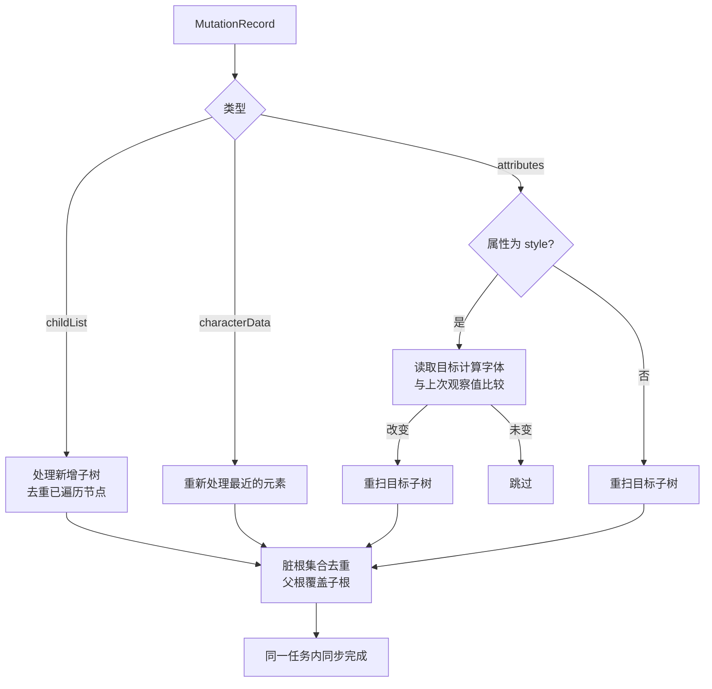

# Design

## Context

当前实现以 `@run-at document-end` 启动，把元素收集到 64 个一批的队列里，用 `requestIdleCallback`（超时 150ms）和 6ms 时间预算分批处理；全量重扫还要经过 75ms 的定时器。每个元素都写入一次内联 `font-family`，并且每个元素都要读取三次伪元素计算样式。用户见到的「先画原字体再切换」来自两处：首次绘制早于 `document-end`，以及首次应用被空闲调度推迟。

约束：单文件油猴脚本，运行于 Chrome / Edge + Tampermonkey；不能使用第三方服务；必须保留网页原字体栈作为缺字回退；用户脚本无法修改浏览器用户样式表，也无法绕过跨域样式表的 CSSOM 限制。

实测数据（Chromium，Playwright）支撑了以下决策：

| 场景 | 首次绘制 | 覆盖生效 | 原字体可见 |
| --- | --- | --- | --- |
| 延迟 700ms 的 `defer` 脚本页面（现有实现） | 12ms | 718ms | 约 706ms |
| 维基百科条目（现有实现） | 472ms | 470ms | 0 |
| 16k 元素页面，解析期同步原型 | 100ms（基线 56ms） | 解析期 | 0 |

## Goals / Non-Goals

**Goals:**

- 首次绘制的内容已经是替换后的字体；不新增闪烁来源。
- 把每个元素的常规开销压到「一次计算样式读取」，写入只发生在确有独立字体声明的元素上。
- 删除设置模块后，脚本只保留分类、保护、应用三个职责。
- 公式、图标、加密字体保持原样，扩展识别面而不引入 `math` 前缀。

**Non-Goals:**

- 不处理 Shadow DOM、Canvas 文字、PDF 阅读器、图片中的文字。
- 不拦截 `CSSStyleSheet.insertRule()`、`replace()`、`adoptedStyleSheets`。
- 不为特定站点编写适配器；雨课堂规则保持现状。
- 不迁移旧的三项字体存储键。
- 不在解析期引入时间预算或让出主线程——那正是闪烁的来源。

## Decisions

### 1. `document-start` + 在 mutation 回调内同步应用

脚本在文档解析开始时安装 `MutationObserver`，在回调中同步完成受影响子树的读取与写入。`MutationObserver` 回调是微任务，在渲染步骤之前执行，因此新插入的内容进入绘制时已经是替换后的字体。

替代方案与取舍：

- 维持 `document-end` + 空闲调度：闪烁无法消除，已由 706ms 的实测证伪。
- 注入 `* { font-family: sans-serif !important }` 之类的全局样式：无法恢复原字体栈与图标字体，无法表达 serif / mono。
- 首屏暂时隐藏再显示：把字体闪烁换成空白闪烁，不可接受。

代价是解析期主线程工作量增加。16k 元素页面实测 +44ms（约 2µs/元素，含 24k 次 `getComputedStyle` 与 8k 次写入），首屏通常只有几百个元素，实际增量远小于此。

外部样式表的规则可能早于其 `load` 事件生效，而这次生效不产生 DOM 变更：解析期扫描可能读到 UA 默认字体而按继承跳过元素，等到 `load` 才重扫时已经晚于首次绘制（真实页面实测维基百科标题晚 43ms）。因此脚本跟踪尚未 `load` / `error` 的 `<link rel="stylesheet">`；只要存在待定样式表，每个渲染更新都保留一次去重的补扫（`requestAnimationFrame` 回调内同步执行），样式表全部落定后停止。补扫不替代 mutation 路径的同步应用，只覆盖「样式已应用、事件尚未派发」的窗口；没有外部样式表的页面不会产生额外扫描。真实页面实测首次写入由晚于 FCP 43ms 变为早于 FCP 13–19ms。

### 2. 只处理独立声明：与父元素不同或自身带字体声明

按文档顺序遍历，读一次自身计算字体系列，与父元素的已知值比较；自身没有字体声明且与父元素相同的元素依赖继承跳过。自身带有内联 `font-family` 或样式表规则的元素即使当前与父元素相同，也会在父元素写入后重新比较并单独处理，否则该元素的声明会继续使用网页原字体。读取阶段先收集计划、不写入，写入阶段统一执行，避免每次写入后触发同步样式重算。

维基百科条目 1550 个元素中只有 43 个与父元素不同，写入量因此从「每元素一次」降到「每独立声明一次」。父元素的值用 `WeakMap` 缓存，子元素在比较时直接复用。

### 3. 遍历时对保护边界整棵剪枝

遍历器在进入元素时用 `element.matches(边界选择器)` 判断是否为保护边界；命中即跳过整棵子树，不再用 `element.closest()` 为每个后代重复判断。边界选择器集中在一个常量里，包含 SVG、`math`、KaTeX、MathJax、加密标记等。仅靠继承获得字体的保护边界会写入一份与其当前计算字体等值的声明（而非通用族），避免祖先的替换前缀渗入边界内部。

伪元素保护不从每个元素读取三次伪元素计算样式：先从可读样式表中收集带 `::before` / `::after` / `::marker` 的选择器，用它们定位本次遍历的候选元素，只对候选读取伪元素计算样式；样式表因跨域而不可读，或选择器含无法独立解析的嵌套 `&` 时，回退为逐个元素检查。样式表文本或链接变化会重建该索引。

### 4. 固定通用族，删除设置链路

`settings.ts` 删除，`index.ts` 只负责启动。分类结果直接映射到 `sans-serif` / `serif` / `monospace`；构建脚本删除四个 `@grant`，`@run-at` 改为 `document-start`。旧存储键既不读取也不删除，避免额外权限。

### 5. 保留原字体栈，前缀去重

写入值仍是「通用族前缀 + 原字体栈」。原字体栈提供通用族缺字时的页内 webfont 回退；前缀已存在时不再追加，保证重扫幂等。

### 6. 分类以名称为先，测量兜底

先按字体栈中的通用类和已知字体名判定 serif / sans；只有非等宽判定必须依赖测量。等宽测量沿用隔离节点与逐字符宽度比较，结果按字体环境缓存。字体加载完成后触发一次重扫，修正「未知等宽 webfont 在加载前被误判」的情况。

### 7. 用宽度比识别未知连字图标字体

对首选字体是网页自带 webfont 的元素，比较一个测试词的整词宽度与逐字符宽度之和，比值低于 0.6 判定为连字图标字体。Material Icons 实测 0.25，Roboto Mono 与 Arial 为 1.00。

「网页自带 webfont」通过遍历 `document.fonts` 得到的 `FontFace.family` 集合判断；系统字体不在其中，因此不会被误判。测量探针复制元素的计算字体特性（`font-feature-settings` 等），否则不会触发连字。仅对每个新字体环境额外测量一次。

### 8. 重扫触发与去重

样式表加载、`document.fonts` 的 `ready` / `loadingdone` / `loadingerror`、`pageshow`、`resize` 触发的重扫同样在同一任务内同步执行。脏根集合会丢弃被其他脏根包含的根，避免同一子树重复处理。

### 9. 读写分离与恢复

重扫一个子树前，先恢复该子树内脚本写入过的内联声明（`WeakMap` 记录原值与写入值），再读取网页计算样式；写入后重新读取序列化结果并记录。这样网页改写内联字体时不会被当成原值，也不会在前缀上继续叠加。自身写入先 `takeRecords` 清空，再临时断开观察器，避免自触发循环。

## Risks / Trade-offs

- [同步解析期扫描阻塞主线程] → 继承跳过、保护剪枝、先读后写、缓存父元素值；实测 16k 元素 +44ms，常规页面远低于此。
- [解析期读取到 UA 默认字体而非站点样式] → 样式表规则可能早于 `load` 事件应用；等待外部样式表期间保留绘制前补扫，真实页面实测标题在 FCP 前完成写入。分类以字体名为先，减少测量依赖。
- [属性频繁变化的页面触发过多重扫] → `style` 变化先做一次计算字体比较，未改变即跳过；脏根去重；子树范围优先于全量。
- [`document.fonts` 可能不枚举跨域样式表中的 `@font-face`] → 遍历集合用于「放宽」图标判定，取不到时退化为原有名单与测量启发式，不影响正确性。
- [网页脚本持续覆盖内联字体] → 同步观察器在同一任务内重新处理，最坏情况与网页自身写入同帧收敛；不保证与逐帧改写 `style` 的组件完全兼容。
- [公式或加密边界完全依赖继承时会继承通用族前缀] → 受保护元素若只靠继承获得字体，会写入与其当前计算字体等值的 `font-family`（带 `!important`），把边界内部与祖先的通用族前缀隔离；已知 KaTeX / MathJax / MathML 容器通常自带字体声明，因此这类等值写入主要发生在动态标记或继承型边界上。边界内部仍不生成任何替换声明。
- [升级后旧自定义字体失效] → 发布说明明确指引改用浏览器字体设置；旧存储键保留不删。
- [连字检测阈值误判] → 仅对网页 webfont 生效、阈值 0.6 远离实测的 0.25 / 1.00；误判后果是保留原字体而非破坏字形。

## Migration Plan

1. 版本号升至 `2.0.0`，移除 `@grant`，`@run-at` 改为 `document-start`。
2. 发布后 Tampermonkey 通过 `.meta.js` 自动更新；脚本名称、namespace 保持不变。
3. 回滚：重新安装 1.x 版本即可恢复设置菜单与旧行为，旧存储键仍在。
4. 回滚不需要数据迁移；脚本不删除任何旧键。

## Open Questions

- 连字图标检测的阈值与测试词表是否需要根据真实站点样本调整（不影响规格与任务拆分，可在实现后按测试结果微调）。
